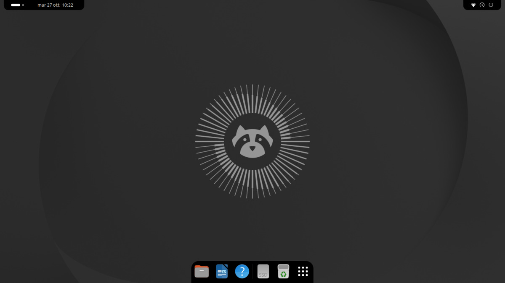
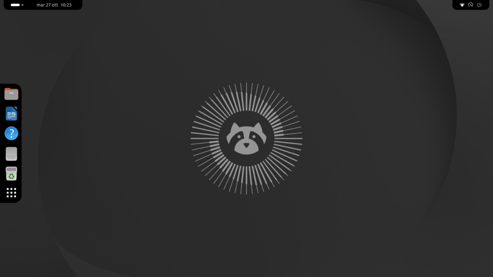
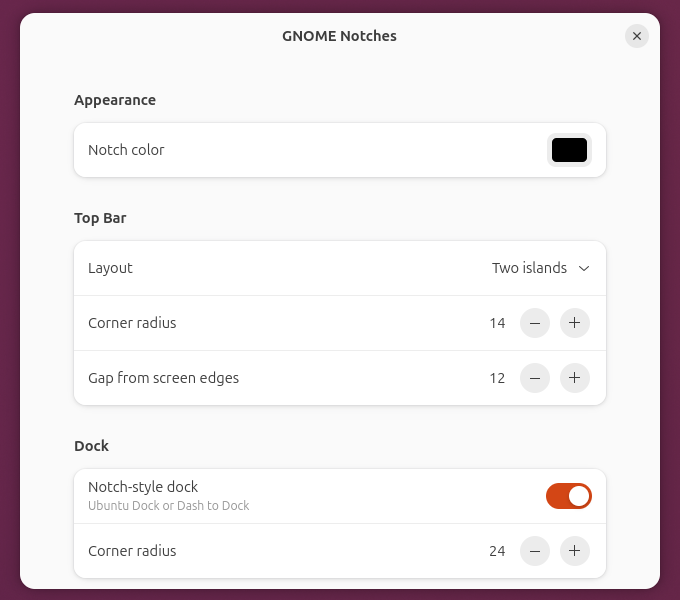

# GNOME Notches

A GNOME Shell 50 extension that turns the top bar into **MacBook-style notches** hanging from the top edge of the screen, and the dock into a **bigger notch** glued to the screen edge it sits on.

- **Two islands** (default): Activities / workspaces, Places and the clock on the left; tray icons and the system menu (Wi-Fi, volume, …) on the right; the center stays empty.
- **Three islands**: like two islands, but the clock keeps its own notch in the middle.
- **Single notch**: everything in one notch in the middle.
- **Dock** (Ubuntu Dock / Dash to Dock): rounded only on the side facing the screen, at the bottom, top, left or right.

Goals: simple, efficient, stable. No dependencies, no timers, no polling.



| Layout | Top bar |
|---|---|
| Two islands |  |
| Three islands |  |
| Single notch |  |

<p align="center"> </p>

## Requirements

- GNOME Shell 50 (tested on 50.1, Wayland, with GNOME's Adwaita theme and Ubuntu's Yaru, light and dark)
- Optional: Ubuntu Dock or Dash to Dock (tested with version 110), with **"extend to edge" off** (`extend-height=false`), otherwise the dock stays a full bar
- Disable other extensions that restyle the panel or the dock (e.g. Open Bar), as they conflict

## Settings

Open them from the Extensions app, or with:

```bash
gnome-extensions prefs gnome-notches@xshys.github.io
```

| Setting | Default |
|---|---|
| Notch color (with transparency, shared by top bar and dock). Panel text turns white or dark automatically to stay readable | black |
| Top bar layout: two islands / three islands / single notch | two islands |
| Top bar corner radius | 14 px |
| Gap between the side notches and the screen edges | 12 px |
| Notch-style dock on/off | on |
| Dock corner radius | 24 px |

Changes apply immediately.

## Install

From a release zip ([Releases](https://github.com/xshys/GNOME-Notches/releases)):

```bash
gnome-extensions install --force gnome-notches@xshys.github.io.shell-extension.zip
```

On Wayland, log out and back in (GNOME only discovers new extensions at login), then:

```bash
gnome-extensions enable gnome-notches@xshys.github.io
```

### From source

```bash
git clone https://github.com/xshys/GNOME-Notches.git
```

```bash
cd GNOME-Notches && glib-compile-schemas schemas/ && ln -sfn "$PWD" ~/.local/share/gnome-shell/extensions/gnome-notches@xshys.github.io
```

Then log out and back in, and enable it as above.

### Build the release zip

```bash
gnome-extensions pack --extra-source=LICENSE --force .
```

## How it works

```
metadata.json   uuid, shell version, settings schema
extension.js    generated stylesheet + panel layout
prefs.js        preferences window (Adwaita)
schemas/        GSettings schema
test/           headless test (isolated GNOME Shell + screenshots)
screenshots/    images for this README
```

**Style the containers, not the buttons.** The GNOME panel has three boxes (`#panelLeft`, `#panelCenter`, `#panelRight`), each sized to its content. The notch background and radius go on the boxes, so each side is one island that grows and shrinks when apps add tray icons. Extensions that style every button instead produce one island per icon.

- **Style**: `extension.js` builds a single stylesheet from the settings (`buildCss()`), writes it to `$XDG_RUNTIME_DIR/gnome-notches@xshys.github.io/notches.css` and loads it into the St theme. On any settings change it unloads it, rewrites it and loads it again. GNOME re-reads custom stylesheets from disk on every theme reload (light/dark switch, user themes), which is why the file lives in the runtime dir and not in `~/.cache`, where cleaners could delete it.
- **Text color**: light shell themes (Adwaita light) use dark panel text, unreadable on a black notch. The text color is derived from the notch color's brightness: white on dark notches, dark on light ones.
- **Layout**: the only JS logic. *Two islands* moves the clock to the end of the left box. *Single notch* moves every item into the center box around the clock, and forwards items that other extensions add to the side boxes later. Every move is recorded and undone in reverse order, so `disable()` (also called by GNOME on every screen lock) restores the original panel exactly.
- **Dock**: CSS only, on `#dashtodockContainer .dash-background`. The dock adds its position (`top/right/bottom/left`) as a style class, which picks the corners to round. The `#uiGroup` prefix only raises specificity above the dock's own rules.

## Testing

```bash
test/run.sh BOTTOM LEFT RIGHT TOP BOTTOM:layout=three-islands BOTTOM:layout=single-notch \
  LEFT:dock=none:layout=three-islands BOTTOM:theme=yaru \
  RIGHT:org/gnome/desktop/interface/color-scheme=prefer-light \
  BOTTOM:theme=yaru:monitors=2:org/gnome/shell/extensions/dash-to-dock/multi-monitor=true
```

Each case starts an isolated headless GNOME Shell: the user's session, settings and files are not touched. A case is `DOCK_POSITION[:key=value...]`:

- `key=value`: an extension setting, e.g. `layout=single-notch`
- `path/key=value`: any other setting, e.g. `org/gnome/desktop/interface/color-scheme=prefer-light`
- `theme=yaru`: Ubuntu's shell theme (default: GNOME's Adwaita)
- `dock=none`: no dock extension; `dock=DIR`: another dock extension (e.g. an unpacked Dash to Dock) instead of Ubuntu Dock
- `monitors=N`: N virtual monitors

- **Automatic checks**: no JS errors; the clock is in the right box; `disable()`/`enable()` cycles restore the panel exactly; live layout changes apply and revert; the stylesheet survives a light/dark theme reload.
- **Screenshots** in `test/out/`: desktop, calendar menu, desktop after the theme switch and preferences window for each case. Appearance is not checked automatically, so look at them.
- Prints `PASS`/`FAIL` (exit code 0/1).
- `NOTCH_EXT_DIR=<unzipped release zip> test/run.sh ...` tests the packaged zip instead of the source tree.

## Known limitations

- No concave corners (the outward curve where a MacBook notch meets the screen edge): St CSS cannot draw them.
- The top bar is only on the primary monitor (as in stock GNOME); the dock notch works on every monitor.
- With the dock at the top, Ubuntu Dock overlaps the middle of the top bar: use the *two islands* layout, which keeps the middle free.
- With the dock in "extend to edge" mode the notch shape is lost.
- The notches stay visible in the overview. On the lock screen GNOME disables the extension, so the stock panel is shown.
- With *two islands*, items other extensions put in the center box float there without a notch: use *three islands*.

## License

GPL-2.0-or-later.
